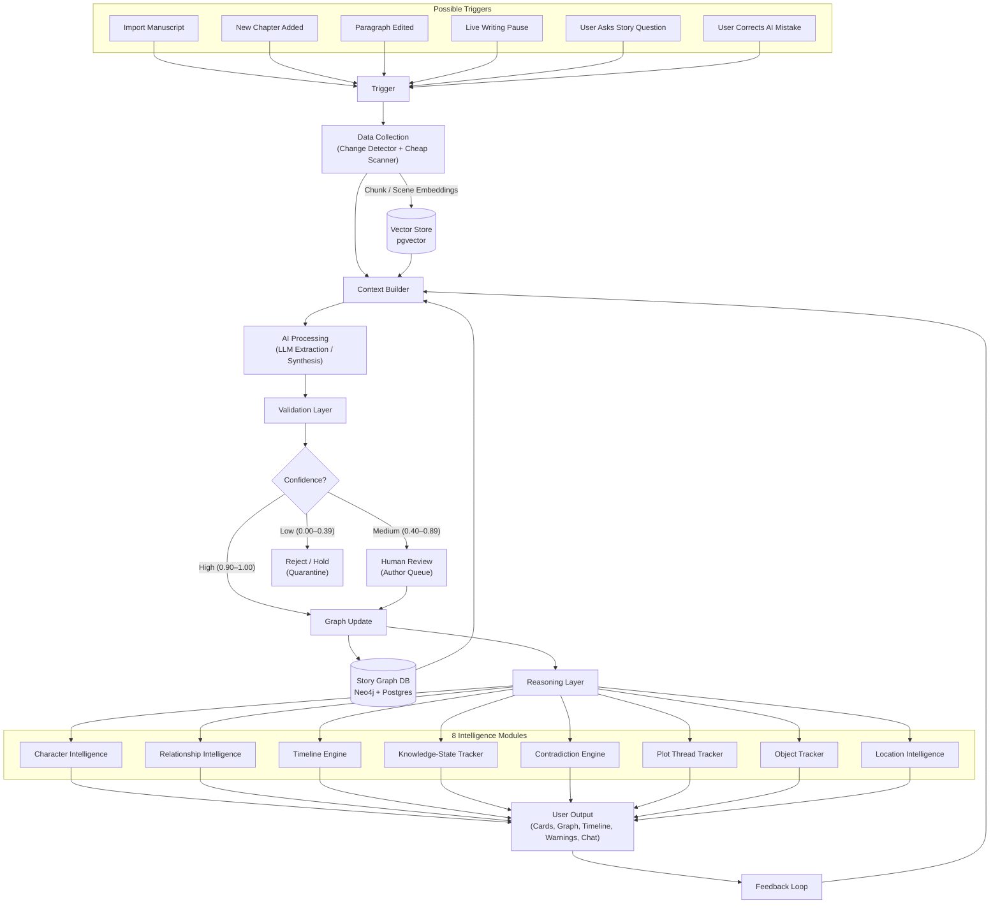

# NERRA — Canonical System Architecture

> Synthesized from the two authoritative sources of truth:
> - **Architecture Diagram:** [`docs/architecture.drawio.xml`](architecture.drawio.xml)
> - **Design Vault:** Obsidian `Story Intelligence Engine` (`01 Architecture/System Overview.md`, `02 Core Pipeline/`, `05 Validation System/`)

---

## 1. Core Mental Model

```text
LLM          = interpreter
Graph        = memory
Validator    = judge
User         = final authority
Vector Store = fuzzy recall
Frontend     = author interface
```

**Core Principle:** The system never sends the full manuscript to the LLM on every change. Instead, it constructs a **compact context packet**:

```text
New or changed text
  + Relevant Graph Memory (entities, aliases, relationships, open threads)
  + Recent Timeline & Epistemic Context
  + Fuzzy Vector Recall
  + Author Feedback / Correction Rules
```

---

## 2. End-to-End Architecture Flow

This flow maps directly to [`docs/architecture.drawio.xml`](architecture.drawio.xml):



### Extension & Research Hooks in [`architecture.drawio.xml`](architecture.drawio.xml)

| Group | Nodes & Targets |
|---|---|
| **Feature Customization** | `Context Builder → Custom Context` · `AI Processing → Custom Prompt` · `Validation Layer → Custom Validation` · `Graph Update → Custom Graph Write` · `User Output → Custom UI Output` |
| **Open Research Areas** | `Large Rewrite Reprocessing → Data Collection` · `World Rule Extraction → AI Processing` · `Pronoun Resolution → Validation Layer` · `Unreliable Narrator → Validation Layer` · `Flashback Detection → Reasoning Layer` · `Plot Thread Resolution → Reasoning Layer` |

---

## 3. Data Persistence Layer (`docker-compose.yml`)

1. **PostgreSQL 16 + `pgvector` (`nerra-postgres`):**
   - Authoritative ACID relational records: users, projects, manuscripts, version snapshots (`manuscript_versions`), verbatim quote evidence, factual claims, timeline events, object custody logs, world rules, and author decisions.
   - Vector recall: 384-dimensional chunk embeddings (`all-MiniLM-L6-v2`) queried via `pgvector` cosine distance.
   - Embeddings must update incrementally (recomputing only changed chapters/chunks).
2. **Neo4j 5 Community (`nerra-neo4j`):**
   - Native graph memory for multi-hop Cypher traversals, relationship evolution edges, and neighborhood expansion.
   - **Canonical Graph Nodes:** `Character`, `Event`, `Location`, `Object`, `Fact`, `Knowledge`, `PlotThread`, `Scene`.
   - **Canonical Graph Edges:** `APPEARS_IN`, `HAS_ALIAS`, `KNOWS`, `LEARNED`, `TOLD`, `OWNS`, `POSSESSES`, `PARTICIPATED_IN`, `OCCURRED_AT`, `BEFORE`, `AFTER`, `CONTRADICTS`, `RELATED_TO`.

---

## 4. Current Codebase Mapping

| Architectural Block | Current Implementation Path | Current Maturity |
|---|---|---|
| **Triggers & Ingestion API** | `backend/app/routers/manuscripts.py`, `backend/app/services/splitter.py` | Batch manuscript import + SHA-256 chapter cache implemented; paragraph-diff & live triggers planned in Phase 3–4 |
| **LLM Interpreter** | `backend/app/services/extractor.py`, `backend/app/services/pipeline.py` | Chapter extraction with quote provenance + Neo4j/SQL sync; `Change Detector`, `Cheap Scanner`, and Graph `Context Builder` planned in Phase 3 |
| **Validation & Intent Gate** | `backend/app/services/extractor.py`, `backend/app/agents/contradiction_reasoner.py` | Verbatim-quote validation + LangGraph intent reasoner (`error` vs `intentional`); pre-graph confidence quarantine (`High`/`Medium`/`Reject-Hold`) planned in Phase 3 |
| **Graph & Vector Memory** | `backend/app/models.py`, `backend/app/services/graph.py`, `backend/app/services/embedder.py` | Postgres + `pgvector` + Neo4j `StoryEntity` graph projection implemented |
| **Reasoning Modules** | `backend/app/services/{consistency,timeline,knowledge,exporter}.py` | Character, Relationship, Dual Timeline, Epistemic Knowledge Matrix, Custody, World Rules, Contradictions implemented; full `Plot Thread Tracker` & `Feature Customization` planned in Phase 3 |
| **Story Chat (Graph RAG)** | `backend/app/agents/story_chat.py` | Intent routing, `pgvector` + Neo4j neighborhood + timeline/knowledge retrieval, context grading retry, verbatim chapter citations |
| **Author Interface** | `frontend/src/app/page.tsx`, `frontend/src/components/` | Next.js dashboard (Issues & Review Queue, Characters & Merge, Story Graph, Dual Timeline, Knowledge Matrix, World & Custody, Claims, Versions, Story Bible Export, Chat) |
