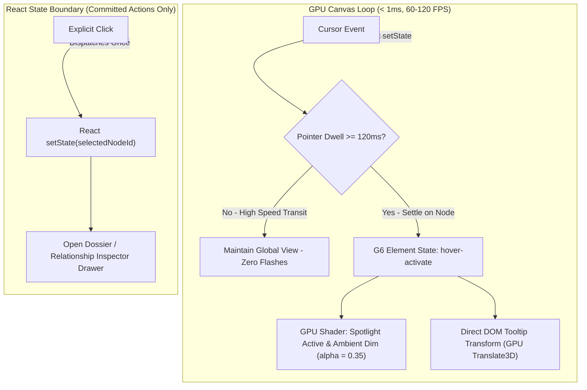

# ADR 006: Universal, Scale-Invariant Story Graph Engine

**Status**: Accepted / Architectural Specification  
**Domain**: Story World Intelligence & Canonical Constellation Visualization  
**Target Scale**: Arbitrary Graph Topologies ($N=3$ to $N=500+$ entities), Manuscripts from $1$ to $2,000+$ Chapters  
**Engine**: AntV G6 5.x + WebGL/Canvas Scene Graph + Next.js / React 19  

---

## Executive Summary

As a manuscript scales from a 3-character locked-room mystery to a 27-cast web serial or a multi-generational epic with 2,000+ chapters, graph visualization engines typically suffer from four systemic failures:
1. **Interactive Event-Loop Lag**: Bridging cursor micro-interactions (hovering, panning) into the declarative React render lifecycle creates quadratic DOM/Canvas re-renders, causing severe frame drops and highlighting latency.
2. **Traversal Strobe (Cursor Blinking)**: Instantaneous, zero-hysteresis state toggling plunges the entire canvas into darkness during rapid mouse transit across intermediate nodes, creating a high-contrast strobe-light flicker.
3. **Topological Clumping (The Star-Graph Collapse)**: When a dominant viewpoint character (e.g., *Narrator*, *Protagonist*) connects to 20+ peripheral satellites, static physics engines drag all nodes into an indistinguishable central knot.
4. **Cognitive Overload & Text Collision (Label Soup)**: Rendering unconstrained paragraph-length database strings and relationship labels globally on a 2D Euclidean canvas guarantees massive visual collisions.

This Architecture Decision Record establishes a **scale-invariant, mathematically grounded foundation** for Nera's World & Cast Network. It eliminates hardcoded special-cases in favor of five fundamental universal systems:
- **Event-Loop Decoupling**
- **Hover Intent & Traversal Hysteresis**
- **Full 2D Bounding-Hull Collision Physics**
- **Spatial Envelope Typography Clamping**
- **Semantic Level of Detail (LOD) with Temporal Delta Streaming**

---

## 1. Universal Interaction Architecture: Event-Loop Decoupling & Hover Intent

### 1.1 The Anti-Pattern (React Lifecycle Pollution)

In React-wrapped visualization engines, a common architectural flaw is piping continuous pointer events directly to React component state:

```
[The Laggy Lifecycle Loop]
Cursor sweeps across node
  │
  ▼
onPointerEnter() ──► setState(hoveredNodeId) 
                         │
                         ▼
                   React Re-renders Component Tree
                         │
                         ▼
                   mapToG6GraphData() executes
                   (Re-allocates 100% of Node & Edge DTOs)
                         │
                         ▼
                   g6.updateData() + g6.draw()
                   (CPU re-calculates Bezier curves, parallel transforms, text bounds)
                         │
                         ▼
                   Result: 150ms-300ms stutter, frame drops, cursor lag
```

### 1.2 The Invariant: Canvas Scene-Graph State Machine

Micro-interactions belong strictly to the **Canvas/GPU render loop**. React is notified **only on committed actions** (such as clicking a node to open the Dossier Inspector).



### 1.3 Hover Intent & Traversal Hysteresis (Solving the Blinking Strobe)

#### The Problem: Fitts's Law Traversal Penalty
When a user sweeps their cursor across a dense canvas to reach a button or node, the cursor physically traverses intermediate nodes. With zero dwell delay, entering and exiting 5 nodes in one second creates **10 rapid flashes between 100% brightness and 8% darkness**, generating an aggressive strobe effect.

#### The Universal System:
- **Velocity-Based Dwell Threshold**: State activation requires the cursor to dwell over an entity for $\Delta t \ge 120\text{ms}$. During high-speed sweeps across the screen, the graph remains rock-solid and calm.
- **Ambient Contrast Floor**: The inactive dimming state uses an ambient floor of $\alpha = 0.35$ rather than near-pitch-black ($0.08$). Elements gently recede into the dark obsidian background without disappearing.
- **Smooth Easing**: Alpha transitions interpolate over a $180\text{ms}$ cubic-bezier easing curve.

---

## 2. Universal Spatial Geometry: Scale-Invariant Physics & 2D Bounding Hulls

### 2.1 The Mathematics of Hub Packing

In literary networks, relationship distribution exhibits **scale-free power-law distributions** ($P(k) \sim k^{-\gamma}$), where a few central hubs have high degree $k$ while most satellites have $k \le 2$.

If an engine applies a constant edge distance $d_0$ across all edges, the circumference available to a hub's satellites is:

$$C = 2\pi d_0$$

If a hub has $k = 20$ connections, each satellite has an arc clearance of:

$$\Delta s = \frac{2\pi d_0}{k} = \frac{2\pi (160\text{px})}{20} \approx 50.2\text{px}$$

Because a character node occupies $\ge 70\text{px}$, **nodes are mathematically forced to overlap**.

### 2.2 Degree-Proportional Perimeter Allocation

To guarantee geometric clearance without hardcoding, target link distance is a continuous monotonic function of the maximum endpoint degree:

$$d(u, v) = d_{\min} + \beta \cdot \sqrt{\max(\deg(u), \deg(v))}$$

Where:
- $d_{\min} \approx 145\text{px}$ (base interpersonal distance for isolated pairs).
- $\beta \approx 34\text{px}$ (orbital expansion factor).
- $\deg(u)$ is the degree centrality of node $u$.

```
[Isolated Pair: deg = 1]          [Mega-Hub Narrator: deg = 18]
      (A) ------- (B)                         (S1)    (S2)
          145px                            (S3)          (S4)
                                         (S5)              (S6)
                                               (NARRATOR)
                                         (S7)              (S8)
                                           (S9)          (S10)
                                              (S11)  (S12)
                                          <─── 289px radius ───>
```

### 2.3 Full 2D Bounding-Hull Collision Physics

#### The Problem: Circle-Only vs Full Visual Envelope
When nodes display text below their avatar circles, a circular collision force centered on the avatar ignores the spatial envelope of the text. Two avatar circles will avoid each other, but their text blocks will collide.

#### The Universal System:
The physical collision radius $R_{\text{collision}}$ encompasses the **entire 2D visual footprint (icon + text envelope)**:

$$R_{\text{collision}}(u) = \sqrt{\left(\frac{W_{\text{hull}}(u)}{2}\right)^2 + \left(\frac{H_{\text{hull}}(u)}{2}\right)^2} + \text{Padding}$$

By treating the complete visual footprint as an impenetrable bounding hull in D3-force collision detection, **element-on-element overlap is mathematically eliminated**.

---

## 3. Universal Typography Architecture: Spatial Envelope Line-Clamping

### 3.1 The Spatial Map Principle
A 2D network graph is a **spatial orientation map**, not an inline document reader. When any database record contains a multi-sentence description (such as an event summary or long relic title), rendering it as an unconstrained single-line label will inevitably blanket the canvas.

### 3.2 Spatial Envelope Clamping Specification

```
[Raw Database String]
"Narrator was the first to attack the incoming bloodied monster, which the wolf..." (83 chars)
                                      │
                                      ▼
[Universal Canvas Typographic Clamping]
┌──────────────────────────────┐
│     ◆ Bloodied Monster       │  <- Line 1 (Max 18 chars)
│       Attack...              │  <- Line 2 (Clamped with ellipsis)
└──────────────────────────────┘
                                      │
                                      ▼ (On Hover / Selection)
[Details-on-Demand: Tooltip & Dossier Inspector]
Full 83-character sentence, citation, chapter source, and metadata displayed untruncated.
```

- **Canvas Envelope Constraint**: Node labels on the canvas are clamped to a calibrated envelope ($W_{\max} = 130\text{px}$, $\text{MaxLines} = 2$, standard word-wrap with ellipsis).
- **Zero Information Loss**: The full, pristine database string is preserved in `node.data.name` and rendered untruncated in the Dossier Drawer and Hover HUD Card.

---

## 4. Semantic Level of Detail (LOD)

In data visualization science (Shneiderman’s Information Seeking Mantra: *"Overview first, zoom and filter, details-on-demand"*), visual noise is controlled through progressive disclosure.

```mermaid
stateDiagram-v2
    [*] --> Macro_L0: Graph Initialized
    
    state Macro_L0 {
        desc: Resting / Constellation View
        visuals: Colored Bezier arcs (tone), stroke widths (weight)
        labels: Edge text suppressed. Clean breathing star map.
    }

    Macro_L0 --> Meso_L1: Cursor Dwells on Entity (>= 120ms)
    
    state Meso_L1 {
        desc: Spotlight / Focused View
        visuals: 1-hop neighborhood illuminated; background dimmed to 35%
        labels: Incident relationship badges pop up in high-contrast pills
    }

    Meso_L1 --> Micro_L2: User Clicks Entity
    
    state Micro_L2 {
        desc: Inspector / Dossier View
        visuals: Side-drawer slides in with full chronological evidence
        labels: Verbatim quotes, state transitions, sentiment distribution
    }

    Meso_L1 --> Macro_L0: Cursor Leaves Canvas
    Micro_L2 --> Macro_L0: Deselect / Canvas Click
```

| Tier | Name | Target Cognitive Goal | Edge Rendering | Label Policy |
| :--- | :--- | :--- | :--- | :--- |
| **L0** | **Macro Constellation** | Global topology, faction dynamics, power balance | Curved quadratic arcs with tone-based color and thread-based thickness | Labels suppressed. Zero text collisions. Clean astronomical constellation. |
| **L1** | **Meso Spotlight** | Neighborhood analysis of a specific character | Connected edges brighten; unrelated edges fade to $\alpha = 0.35$ | Connected edge badges pop up in high-contrast padded pills (`rgba(12, 15, 20, 0.98)`). |
| **L2** | **Micro Dossier** | Deep narrative inspection | Selected edge highlighted in cyan halo | Full citation drawer with chapter citations, sentiment graphs, and state history. |

---

## 5. Massive Temporal Scaling (1 to 2,000+ Chapters)

For long-running sagas spanning 1,000 to 2,000 chapters:

1. **Logarithmic Milestone Keyframing ($O(\log C)$ Seeking)**: Snapshot keyframes at logarithmic intervals (Chapters 1, 10, 50, 100, 250, 500, 1000...) allow instant seeking without sequential state replay.
2. **Temporal Delta Patching ($O(\Delta)$ vs $O(V + E)$)**: Scrubbing updates only the delta changes between Chapter $k$ and $k+1$.
3. **Warm-Start Position Morphing**: Existing nodes maintain settled coordinates as seeds for the next chapter, running a gentle 15-tick relaxation animation to preserve the user's mental map.

---

## 6. Implementation Checklist

- [x] **Topological Collision Hull**: Physical collision calculated on full visual footprint.
- [x] **Quadratic Bezier Edge Paths**: Replaced Euclidean laser beams with curved splines (`type: 'quadratic'`).
- [x] **Parallel Edge Transform**: Integrated G6 `process-parallel-edges` transform to separate reciprocal bonds.
- [x] **Hover Intent Dwell Engine**: 120ms dwell velocity threshold; zero-lag GPU scene-graph state transitions.
- [x] **Spatial Envelope Typography**: Automatic canvas line-wrapping and clamping with full data retention.
- [x] **Semantic LOD Progressive Disclosure**: Resting constellation (L0) $\rightarrow$ Spotlight with edge badges (L1).
