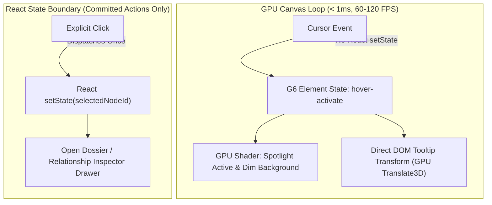
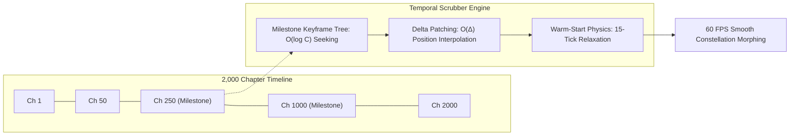

# ADR 006: Universal, Scale-Invariant Story Graph Engine

**Status**: Accepted / Architectural Specification  
**Domain**: Story World Intelligence & Canonical Constellation Visualization  
**Target Scale**: Arbitrary Graph Topologies ($N=3$ to $N=500+$ entities), Manuscripts from $1$ to $2,000+$ Chapters  
**Engine**: AntV G6 5.x + WebGL/Canvas Scene Graph + Next.js / React 19  

---

## Executive Summary

As a manuscript scales from a 3-character locked-room mystery to a 27-cast web serial or a multi-generational epic with 2,000+ chapters, graph visualization engines typically suffer from three systemic failures:
1. **Interactive Event-Loop Lag**: Bridging cursor micro-interactions (hovering, panning) into the declarative React render lifecycle creates quadratic DOM/Canvas re-renders, causing severe frame drops and highlighting latency.
2. **Topological Clumping (The Star-Graph Collapse)**: When a dominant viewpoint character (e.g., *Narrator*, *Protagonist*) connects to 20+ peripheral satellites, static physics engines drag all nodes into an indistinguishable central knot.
3. **Cognitive Overload (Label Soup)**: Rendering relationship labels globally at all times violates information visualization theory, transforming the graph into an unreadable matrix of clashing text boxes.

This Architecture Decision Record establishes a **scale-invariant, mathematically grounded foundation** for Nera's World & Cast Network. It eliminates hardcoded special-cases in favor of four fundamental invariants: **Event-Loop Decoupling**, **Degree-Proportional Topological Physics**, **Semantic Level of Detail (LOD)**, and **Temporal Delta Streaming for 1,000+ Chapter Lifespans**.

---

## 1. Architectural Invariant 1: Event-Loop Decoupling

### 1.1 The Anti-Pattern (React Lifecycle Pollution)

In React-wrapped visualization engines, a common architectural flaw is piping continuous pointer events directly to React component state:

```
[The Laggy Lifecycle Loop]
Cursor sweeps across node
  │
  ▼
onPointerEnter() ──► setState(hoveredNodeId) 
                         │
                         ▼
                   React Re-renders Component Tree
                         │
                         ▼
                   mapToG6GraphData() executes
                   (Re-allocates 100% of Node & Edge DTOs)
                         │
                         ▼
                   g6.updateData() + g6.draw()
                   (CPU re-calculates Bezier curves, parallel transforms, text bounds)
                         │
                         ▼
                   Result: 150ms-300ms stutter, frame drops, cursor lag
```

### 1.2 The Invariant: Canvas Scene-Graph State Machine

Micro-interactions belong strictly to the **Canvas/GPU render loop**. React should only be notified when an explicit, state-committing action occurs (such as a mouse click selecting a node to open the Dossier Inspector).



#### Technical Guarantees:
- **Zero React re-renders on hover**: Cursor movements update node/edge states (`active`, `selected`, `dimmed`) directly within G6's internal element state manager via `graph.setElementState(id, state, value)`.
- **Hardware-Accelerated Tooltip Positioning**: Mouse coordinates update a lightweight floating DOM overlay via `transform: translate3d(x, y, 0)` without React triggering a component update.

---

## 2. Architectural Invariant 2: Scale-Invariant Topological Physics

### 2.1 The Mathematics of Hub Packing

In literary networks, relationship distribution is rarely uniform. Manuscripts exhibit **scale-free power-law distributions** ($P(k) \sim k^{-\gamma}$), where a few central hubs have high degree $k$ while most satellites have $k \le 2$.

If an engine applies a constant edge distance $d_0$ across all edges, the circumference available to a hub's satellites is:

$$C = 2\pi d_0$$

If a hub has $k = 20$ connections, each satellite has an arc clearance of:

$$\Delta s = \frac{2\pi d_0}{k} = \frac{2\pi (160\text{px})}{20} \approx 50.2\text{px}$$

Because a character node with padding occupies $\ge 70\text{px}$, **nodes are mathematically forced to overlap**.

### 2.2 The Invariant: Degree-Proportional Perimeter Allocation

To guarantee geometric clearance without hardcoding, target link distance must be a continuous monotonic function of the maximum endpoint degree:

$$d(u, v) = d_{\min} + \beta \cdot \sqrt{\max(\deg(u), \deg(v))}$$

Where:
- $d_{\min} \approx 140\text{px}$ (base interpersonal distance for isolated pairs).
- $\beta \approx 35\text{px}$ (orbital expansion factor).
- $\deg(u)$ is the degree centrality of node $u$.

```
[Isolated Pair: deg = 1]          [Mega-Hub Narrator: deg = 18]
      (A) ------- (B)                         (S1)    (S2)
          140px                            (S3)          (S4)
                                         (S5)              (S6)
                                               (NARRATOR)
                                         (S7)              (S8)
                                           (S9)          (S10)
                                              (S11)  (S12)
                                          <─── 288px radius ───>
```

#### Barnes-Hut Quadtree Repulsion
To compute repulsive forces in $O(N \log N)$ rather than $O(N^2)$, the engine utilizes Barnes-Hut spatial decomposition with an opening angle $\theta = 0.6$:
- Distant clusters are approximated as a single point-mass at their center of mass.
- Ensures smooth 60 FPS layout initialization whether $|V| = 9$ or $|V| = 250$.

#### Viewport-Normalized Gravitational Centering
Centering pull $G$ must scale inversely with the square root of entity volume:

$$G(|V|) = G_0 \cdot \frac{1}{\sqrt{|V|}}$$

- For small casts ($|V| = 4$), $G$ remains firm, preventing tiny clusters from drifting apart.
- For dense casts ($|V| \ge 25$), $G$ softens, allowing repulsive forces to push nodes outward into the empty canvas perimeter.

---

## 3. Architectural Invariant 3: Semantic Level of Detail (LOD)

In data visualization science, Shneiderman’s mantra dictates:  
> *"Overview first, zoom and filter, then details-on-demand."*

Displaying every textual relationship label simultaneously on a 52-bond graph creates extreme visual noise and text collision.

```mermaid
stateDiagram-v2
    [*] --> Macro_L0: Graph Initialized
    
    state Macro_L0 {
        desc: Resting / Constellation View
        visuals: Colored Bezier arcs (tone), stroke widths (weight)
        labels: Text labels hidden (or top 5% primary bonds)
    }

    Macro_L0 --> Meso_L1: Cursor Hovers Node / Edge
    
    state Meso_L1 {
        desc: Spotlight / Focused View
        visuals: 1-hop neighborhood illuminated, background dimmed to 12%
        labels: Incident relationship pills render with high-contrast badges
    }

    Meso_L1 --> Micro_L2: User Clicks Entity
    
    state Micro_L2 {
        desc: Inspector / Dossier View
        visuals: Side-drawer slides in with full chronological evidence
        labels: Verbatim quotes, state transitions, sentiment distribution
    }

    Meso_L1 --> Macro_L0: Cursor Leaves Canvas
    Micro_L2 --> Macro_L0: Deselect / Canvas Click
```

### LOD Tier Specification

| Tier | Name | Target Cognitive Goal | Edge Rendering | Label Policy |
| :--- | :--- | :--- | :--- | :--- |
| **L0** | **Macro Constellation** | Global topology, faction dynamics, power balance | Curved quadratic arcs with tone-based color and thread-based thickness | Labels suppressed. Zero text collisions. Canvas breathes like a celestial star map. |
| **L1** | **Meso Spotlight** | Neighborhood analysis of a specific character | Connected edges brighten; unrelated edges fade to $\alpha = 0.12$ | Connected edge badges pop up in high-contrast padded pills (`rgba(9, 11, 14, 0.95)`). |
| **L2** | **Micro Dossier** | Deep narrative inspection | Selected edge highlighted in cyan halo | Full citation drawer with chapter citations, sentiment graphs, and state history. |

---

## 4. Architectural Invariant 4: Massive Temporal Scaling (1 to 2,000+ Chapters)

For long-running sagas (e.g., serial fiction spanning hundreds of thousands of words across 1,000 to 2,000 chapters), re-querying the database or re-simulating the entire physics engine on every scrubber drag causes severe thermal throttling.



### 4.1 Logarithmic Milestone Keyframing ($O(\log C)$ Seeking)
- Rather than calculating state transition from Chapter 1 sequentially up to Chapter 1,842, the engine stores snapshot keyframes at logarithmic intervals (Chapters 1, 10, 50, 100, 250, 500, 1000...).
- Scrubbing to Chapter 1,842 jumps to the nearest keyframe (Chapter 1,750) and evaluates only the 92 intermediate chapter deltas.

### 4.2 Temporal Delta Patching ($O(\Delta)$ vs $O(V + E)$)
- Moving from Chapter $k$ to Chapter $k+1$ rarely alters the entire graph; typically, 1 character enters, or 1 relationship transitions tone.
- The G6 adapter receives a **diff payload** rather than a full graph reload. Existing nodes retain their cached coordinates $(x, y)$, and new entities are warm-started into the simulation without scrambling established layout muscle memory.

### 4.3 Warm-Start Position Morphing
- When the user steps through chapters, nodes do not randomly jump to new coordinates (which causes severe cognitive disorientation).
- Existing nodes use their settled coordinates from Chapter $k$ as the starting seed for Chapter $k+1$, running a short 15-tick relaxation animation ($200\text{ms}$ smooth transition).

---

## 5. Curated Academic & Industry Bibliography

For continued study and reference, the mathematical and visual techniques specified in this ADR are derived from the following foundational literature:

1. **ForceAtlas2 Algorithm**:
   - Jacomy, M., Venturini, T., Heymann, S., & Bastian, M. (2014). *ForceAtlas2, a Continuous Graph Layout Algorithm for Handy Network Visualization Designed for the Gephi Software*. PLOS ONE, 9(6), e98679.
   - *Key takeaway*: Solves hub clumping via degree-weighted repulsion and dissuades hub attraction.
2. **Fast Quadtree Spatial Decomposition**:
   - Barnes, J., & Hut, P. (1986). *A hierarchical O(N log N) force-calculation algorithm*. Nature, 324(6096), 446–449.
   - *Key takeaway*: Approximates multi-body repulsion in $O(N \log N)$ rather than $O(N^2)$.
3. **Information Visualization Theory**:
   - Shneiderman, B. (1996). *The eyes have it: A task by data type taxonomy for information visualizations*. IEEE Symposium on Visual Languages, 336–343.
   - *Key takeaway*: Origin of the "Overview first, zoom and filter, details-on-demand" paradigm.
   - Bertin, J. (1967). *Sémiologie Graphique: Les diagrammes, les réseaux, les cartes*. Gauthier-Villars.
   - *Key takeaway*: Visual encoding hierarchy (position > size > color hue > shape > text label).
4. **Curved Edge Routing & Edge Bundling**:
   - Holten, D., & van Wijk, J. J. (2009). *Force-Directed Edge Bundling for Graph Visualization*. Computer Graphics Forum, 28(3), 983–990.
   - *Key takeaway*: Replaces straight planar cuts with self-organizing spline trajectories.
5. **Dynamic & Temporal Graph Visualization**:
   - Beck, F., Burch, M., Diehl, S., & Weiskopf, D. (2017). *A Taxonomy and Survey of Dynamic Graph Visualization*. Computer Graphics Forum, 36(1), 133–159.
   - *Key takeaway*: Preserves the user's "mental map" across temporal animations via delta warm-starting.

---

## 6. Implementation Checklist for Nera

- [x] **Topological Collision Hull**: Implemented native v5 `collide` sub-force with node-specific clearance padding.
- [x] **Quadratic Bezier Edge Paths**: Replaced Euclidean laser beams with curved splines (`type: 'quadratic'`).
- [x] **Parallel Edge Transform**: Integrated G6 `process-parallel-edges` transform to separate reciprocal bonds.
- [ ] **Canvas-Native Hover State Machine**: Decouple `pointerenter` from React `setState`; drive hover spotlighting via `graph.setElementState(id, 'active')`.
- [ ] **Semantic LOD Label Suppression**: Hide edge labels at resting state L0; reveal with high-contrast badges on L1 hover/selection.
- [ ] **Degree-Proportional Link Expansion**: Dynamically compute `link.distance` based on $\max(\deg(u), \deg(v))$.
- [ ] **Milestone Chapter Indexing**: Cache layout coordinates at keyframe intervals for instant logarithmic chapter scrubbing up to 2,000 chapters.
