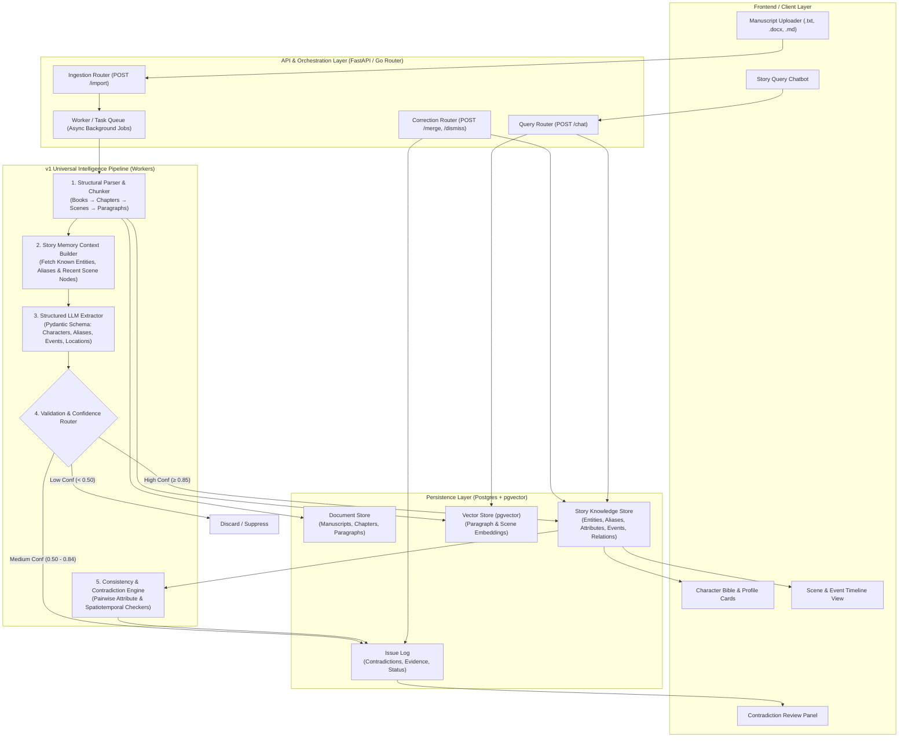
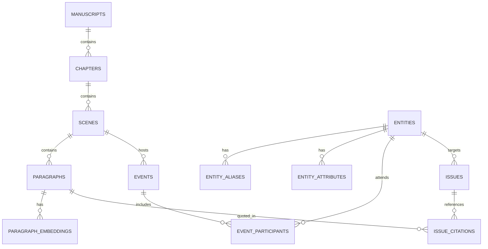

# Nerra v1 — System Architecture & Universal Pipeline

> **Connecting the Original Vision to Version 1**  
> Based on the *Story Intelligence Engine Universal Processing Blueprint* (`Untitled Diagram.json` / `archtitecture.md` / `Project Vision.md`), optimized and hardened for Version 1 execution.

---

## 1. Vision & Original Architecture Alignment

The original architectural blueprint outlines an end-to-end intelligence engine with 8 processing stages, 8 intelligence modules, and a closed-loop human feedback system.

### Identified Flaws in the Original Diagram & v1 Resolutions

| Original Diagram Flaw | Consequence | v1 Hardened Architecture |
| :--- | :--- | :--- |
| **1. Direct Synchronous Ingestion**<br>Diagram shows event router directly invoking AI service synchronously for all events. | Ingesting a 70,000-word book blocks HTTP connections, times out, and crashes under rate limits. | **Decoupled Asynchronous Processing:** File uploads trigger background worker jobs (via Redis/Task queue). Synchronous endpoints are reserved *only* for low-latency Story Chat queries. |
| **2. Monolithic 8-Module AI Pass**<br>All 8 modules (Characters, Relationships, Timelines, Knowledge, Contradictions, Plot Threads, Objects, Locations) run in parallel from day one. | Graph explosion, high token cost, compounding hallucinations, and debugging nightmare. | **Phased Core Module Scope:** v1 focuses exclusively on **Characters & Aliases**, **Locations**, **Chronological Events**, and **Physical/Presence Contradictions**. Relationships, Knowledge States, and Objects follow in v2. |
| **3. Naive Graph Updates Without Strict Provenance**<br>AI outputs written directly into graph entities without granular source span locks. | Graph pollution: false facts corrupt downstream chapters, and contradictions cannot pinpoint the exact line. | **Deterministic Span Provenance:** Every entity, attribute, and event is anchored to an immutable `(chapter_id, scene_id, paragraph_id, text_snippet)`. If the AI asserts "Sarah has green eyes", it must quote the exact paragraph. |
| **4. Premature Live Writing Mode**<br>Debounced keystroke processing included before the core ingestion pipeline is battle-tested. | High complexity dealing with document OT/CRDTs and intermediate incomplete sentences. | **Batch & Incremental Chapter Ingestion for v1:** Optimized for chapter and full manuscript imports. Live keystroke editor is deferred to v3. |

---

## 2. High-Level v1 Architecture Diagram



---

## 3. The 8-Step Universal Processing Blueprint (v1 Execution)

Every ingestion event follows this deterministic 8-step cycle:

### Step 1: Trigger
- **Triggers in v1**:
  - `IMPORT_MANUSCRIPT`: Uploading a complete manuscript or batch of chapters.
  - `ADD_CHAPTER`: Appending a new chapter to an existing story.
  - `STORY_QUERY`: Author asking a question in Story Chat.
  - `USER_CORRECTION`: Author merging characters, editing an attribute, or marking an issue as intentional.

### Step 2: Data Collection & Structural Parsing
- Cleans and normalizes incoming text.
- Splits into hierarchical units: **Document $\to$ Chapters $\to$ Scenes $\to$ Paragraphs**.
- Generates a persistent fingerprint and sequential paragraph index for every paragraph (`p_001`, `p_002`, etc.).
- Computes dense vector embeddings for semantic search and stores them in `pgvector`.

### Step 3: Story Memory Context Builder
- Avoids the expensive anti-pattern of feeding the whole book into each prompt.
- For each scene, the Context Builder retrieves:
  1. **Known Canonical Entities & Aliases**: e.g., *"Sarah Mitchell (Miss Mitchell, Sarah)"*.
  2. **Active Scene Context**: The characters, location, and key facts established in the preceding 1–2 scenes.
  3. **Open Contradiction Watches**: Traits currently under observation.
- Packages this into a compact context packet ($\sim 500-1000$ tokens) injected into the extraction prompt.

### Step 4: AI Processing (Structured LLM Extractor)
- Strict JSON Schema enforcement via Pydantic.
- Extracts:
  - **Characters & Aliases**: Detects explicit names, titles, and nicknames.
  - **Physical Traits & Attributes**: Extracts explicit descriptions (e.g., `eye_color: green`, `hair: blonde`, `status: alive`).
  - **Events**: Identifies key actions, participants, and scene locations.
  - **Locations**: Detects settings (e.g., `The Blackwood Tavern`, `St. Jude Hospital`).
  - **Citations**: Requires an exact substring quotation matching an existing paragraph.

### Step 5: Validation Layer & Confidence Routing
The LLM *proposes*; the validator *decides*:
- **Algorithmic Guardrails**:
  - Exact quote verification (does the quoted sentence actually exist in that paragraph?).
  - Schema conformity (reject malformed JSON).
  - Common false positive elimination (filters out days of the week, months, or common nouns mistaken for characters).
- **Confidence Bands**:
  - **High Confidence ($\ge 0.85$)**: Auto-commit to the Story Knowledge Store.
  - **Medium Confidence ($0.50 - 0.84$)**: Flag as candidate; if conflicting with canon, route to the Author Review Queue.
  - **Low Confidence ($< 0.50$)**: Discard without polluting the graph.

### Step 6: Story Knowledge Store Updates
- Upserts canonical nodes and aliases:
  - If `Miss Mitchell` is identified as `Sarah Mitchell`, an alias edge `(Sarah Mitchell)-[:HAS_ALIAS]->(Miss Mitchell)` is created.
- Inserts versioned attribute records with exact paragraph citations:
  ```json
  {
    "entity_id": "char_sarah_01",
    "attribute": "eye_color",
    "value": "green",
    "source_chapter": 2,
    "source_paragraph_id": "p_045",
    "quote": "Her bright green eyes caught the morning light."
  }
  ```

### Step 7: Reasoning & Consistency Engine
Runs automated pairwise checks across extracted facts:
1. **Physical Attribute Contradictions**:
   - Compares all values for `(entity_id, attribute_name)`.
   - If `char_sarah_01.eye_color` has `green` (Ch. 2) and `blue` (Ch. 14), flags an issue:
     - `severity`: `HIGH`
     - `type`: `PHYSICAL_CONTRADICTION`
     - `citations`: [Ch. 2, p. 45 vs. Ch. 14, p. 112]
2. **Spatiotemporal / Co-Presence Conflicts**:
   - If `char_marcus_02` is in an event at `London` in Ch. 5, and in an event at `Tokyo` in Ch. 5 scene 2 without transit, flags `TIMELINE_DISCREPANCY`.
3. **Status Inconsistencies**:
   - If an entity has a `DECEASED` event in Ch. 6, any dialogue or action in Ch. 9 triggers a `STATUS_VIOLATION`.

### Step 8: User Output & Feedback Loop (Human-in-the-Loop)
- **Review Queue**: The author reviews flagged issues with side-by-side excerpts.
- **Author Actions**:
  - **Merge Entities**: Combine two characters into one (re-indexes all mentions).
  - **Mark Intentional**: Suppresses the contradiction (e.g., Sarah is wearing colored contact lenses or an unreliable narrator is lying).
  - **Edit Fact**: Manually fix an erroneous attribute.
- All actions immediately update the knowledge store and suppress false positives permanently.

---

## 4. v1 Data Model (PostgreSQL + pgvector)

The relational schema implements the graph nodes and edges cleanly without requiring an external graph database for v1:



### Core Table Definitions

1. `entities`:
   - `id`: UUID (Primary Key)
   - `project_id`: UUID
   - `canonical_name`: VARCHAR
   - `entity_type`: ENUM (`CHARACTER`, `LOCATION`, `GROUP`)
   - `first_appearance_chapter`: INT
   - `last_appearance_chapter`: INT
   - `status`: ENUM (`ALIVE`, `DECEASED`, `UNKNOWN`)
   - `created_at`: TIMESTAMP

2. `entity_aliases`:
   - `id`: UUID
   - `entity_id`: UUID (Foreign Key $\to$ `entities.id`)
   - `alias`: VARCHAR (Unique per project)

3. `entity_attributes`:
   - `id`: UUID
   - `entity_id`: UUID (Foreign Key $\to$ `entities.id`)
   - `attribute_name`: VARCHAR (e.g., `eye_color`, `hair_color`, `occupation`)
   - `attribute_value`: TEXT
   - `source_paragraph_id`: UUID (Foreign Key $\to$ `paragraphs.id`)
   - `source_chapter`: INT
   - `confidence`: FLOAT
   - `quote`: TEXT

4. `events`:
   - `id`: UUID
   - `scene_id`: UUID (Foreign Key $\to$ `scenes.id`)
   - `chapter_num`: INT
   - `narrative_order`: INT
   - `location_id`: UUID (Foreign Key $\to$ `entities.id`, nullable)
   - `summary`: TEXT
   - `source_paragraph_id`: UUID

5. `issues`:
   - `id`: UUID
   - `project_id`: UUID
   - `issue_type`: ENUM (`PHYSICAL_CONTRADICTION`, `SPATIOTEMPORAL_CONFLICT`, `STATUS_VIOLATION`)
   - `severity`: ENUM (`HIGH`, `MEDIUM`, `LOW`)
   - `title`: VARCHAR
   - `description`: TEXT
   - `status`: ENUM (`OPEN`, `RESOLVED`, `INTENTIONAL_DISMISSED`)
   - `created_at`: TIMESTAMP

---

## 5. Summary of v1 Readiness

This v1 architecture directly executes the vision from your original `Untitled Diagram` while curing the three critical failure modes:
1. **No unbuffered synchronous choke points** during heavy book ingestion.
2. **Deterministic quote provenance** on every entity attribute to prevent graph pollution.
3. **Rigid focus on the high-value core** (Character Bible, Chronological Timeline, Contradiction Engine, Story Chat).
