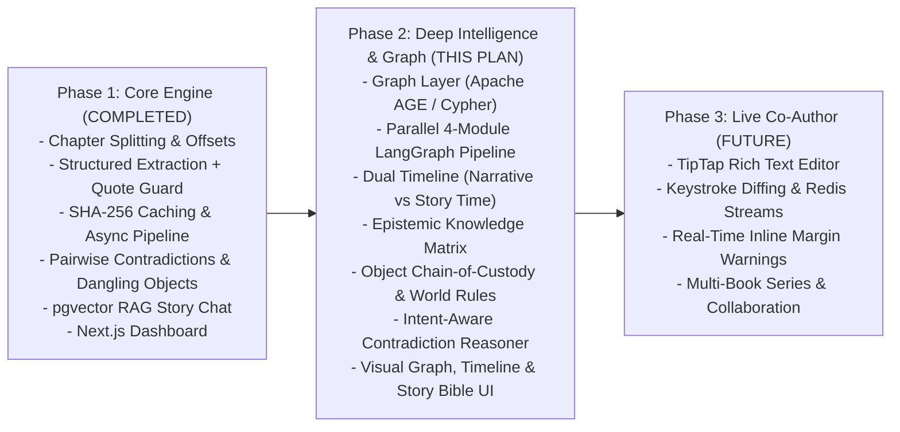
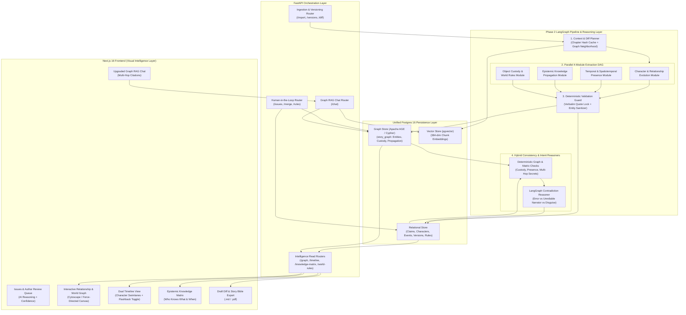
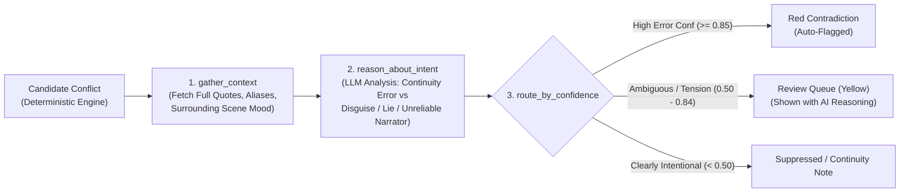
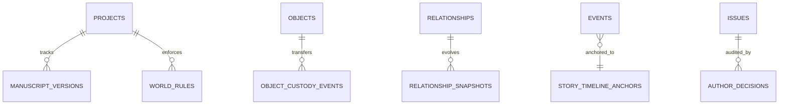

# Nerra Phase 2 — Architecture & Implementation Plan

> **Bridging Version 1 to the Full Narrative Intelligence Engine**  
> Built directly on top of the verified v1 core ([`docs/V1_ARCHITECTURE.md`](file:///Users/adarshchauhan/Desktop/Desktop%20-%20Adarsh%E2%80%99s%20MacBook%20Pro/01_Projects/nerra/docs/V1_ARCHITECTURE.md)) and aligned with the long-term blueprint in [`implementation_phases.md`](file:///Users/adarshchauhan/Desktop/Desktop%20-%20Adarsh%E2%80%99s%20MacBook%20Pro/01_Projects/nerra/implementation_phases.md) and the Obsidian Vision (`Universal Processing Blueprint`).

---

## 1. Where Phase 2 Fits in the Overall Vision

Nerra's complete product vision spans three architectural evolutions:

### What Phase 1 Solved vs. What Phase 2 Unlocks
In **Phase 1**, Nerra proved the foundational loop: prose enters, an LLM extracts structured facts anchored to exact verbatim quotes, deterministic Python detects attribute contradictions, and pgvector powers citation-grounded Q&A.

However, Phase 1 treats chapters largely as flat chronological buckets and stores relationships as simple 1-hop rows. **Phase 2** solves the harder narrative reasoning problems required for real novelists:
1. **Non-Linear Storytelling:** Novels use flashbacks, parallel POVs, and time skips. *Chapter 4 might happen 10 years before Chapter 1.*
2. **Multi-Hop Information Propagation:** If Alice tells Bob a secret in Ch. 3 and Bob tells Charlie in Ch. 5, Charlie knows it—even if he never witnessed the original event.
3. **Dynamic State Over Time:** Characters move across cities, relationships flip from *ally* to *enemy*, and objects change hands.
4. **Intentional Narrative Tension vs. Author Error:** An unreliable narrator lying or a character in disguise looks like a "contradiction" to a naive rule checker, but an intelligent reasoner understands narrative intent.

---

## 2. High-Level Phase 2 System Architecture

Phase 2 preserves Postgres as the **Single Source of Truth** while activating **Apache AGE** (or a synchronized graph projection) inside Postgres alongside `pgvector`, eliminating dual-write sync failure between separate databases.

---

## 3. The 6 Architectural Pillars of Phase 2

### Pillar 1: Unified Graph Layer (PostgreSQL + Apache AGE) & Relationship Evolution
*Directly answers the transition from relational tables to true graph traversal.*

- **Why Apache AGE Inside Postgres 16:**
  - Instead of operating a separate Neo4j cluster (which introduces dual-write sync issues when a chapter is re-analyzed or deleted), **Apache AGE** runs native **openCypher** queries directly inside PostgreSQL.
  - Deleting or re-analyzing a chapter updates Relational rows, `pgvector` embeddings, and `story_graph` Cypher vertices/edges in a **single ACID transaction**.
  - *(Fallback option if container image swap is deferred: A dedicated `GraphProjectionService` backed by `networkx` / recursive SQL CTEs exposing the exact same graph interface so the API and UI stay identical and swappable to AGE/Neo4j).*
- **Graph Schema (`story_graph`):**
  - **Vertices:** `(:Character)`, `(:Location)`, `(:Object)`, `(:Event)`, `(:Fact)`.
  - **Temporal Edges:**
    - `(:Character)-[:RELATED_TO {type, sentiment, since_chapter, until_chapter}]->(:Character)`
    - `(:Character)-[:LOCATED_IN {chapter, scene_order, story_time}]->(:Location)`
    - `(:Character)-[:POSSESSES {since_chapter, until_chapter, transfer_type}]->(:Object)`
    - `(:Character)-[:KNOWS {since_chapter, how_learned, source_char}]->(:Fact)`
    - `(:Character)-[:TOLD {chapter, fact_id}]->(:Character)`

---

### Pillar 2: Dual Timeline Engine & Spatiotemporal Presence Checker
Novels rarely happen in strictly linear order. Phase 2 separates **when the reader reads it** from **when it actually happened**:

1. **Dual Coordinates on Every `StoryEvent`:**
   - `narrative_order`: `(chapter_number, scene_index)` — position in the book.
   - `story_time_order`: normalized chronological sequence index inferred from temporal markers (*"three years earlier"*, *"that same evening"*, *"the next morning"*).
   - `is_flashback` / `temporal_anchor`: explicit markers extracted per scene.
2. **Spatiotemporal Conflict Detection:**
   - Tracks each character's inferred location across consecutive scenes in **story-chronological order**.
   - Flags `spatiotemporal_conflict` if Character `X` appears at `Location A` and `Location B` within the same story-time window without a plausible transition event.
3. **Time Gap Detection:**
   - Flags large unexplained story-time jumps between consecutive scenes when characters' states/injuries fail to reflect the elapsed time.

---

### Pillar 3: Full Epistemic Knowledge Propagation Matrix
Upgrades v1's flat `knows_about` check into a true **multi-hop epistemic graph**:

- **Knowledge Matrix:** `Knows(Character, Fact) -> {knows: bool, since_story_time, since_chapter, how_learned, source_character}`
- **Information Propagation:**
  - If `Park` learns `"the curator was poisoned"` in Ch. 2 (`witnessed`), and tells `Deputy Miller` in Ch. 3 (`told`), the graph propagates `(Deputy Miller)-[:KNOWS {since: Ch. 3}]->(Fact)`.
  - If `Deputy Miller` references or acts upon `"the poison"` in Ch. 1 (in story-chronological time), a multi-hop **Knowledge Violation** is raised with the full causal chain!
- **Dramatic Irony Visibility:** Authors can inspect the Knowledge Matrix at any chapter `N` to verify which characters know a secret and which are still in the dark—crucial for mysteries and thrillers.

---

### Pillar 4: Object Chain-of-Custody & World Rules Engine
1. **Object Chain-of-Custody:**
   - Upgrades `StoryObject` from a simple `mention_chapters` list into a state-tracked possession log (`object_custody_events`).
   - Tracks transitions: `Unknown -> Sarah (Ch. 1, coat pocket) -> Bellweather Safe (Ch. 2) -> Missing (Ch. 3)`.
   - Flags **Custody Paradoxes** (e.g., an object locked in a safe or destroyed in Ch. 2 appearing in someone's hand in Ch. 4 without a retrieval event).
2. **World Rules Engine:**
   - New `world_rules` table storing both **AI-extracted rules** (*"Magic requires silver blood"*, *"No faster-than-light communication"*) and **Author-defined manual rules**.
   - A dedicated checker evaluates new chapter claims against active `world_rules` to surface `world_rule_violation` issues.

---

### Pillar 5: LangGraph Contradiction Intent Reasoner & Author Review Queue
Phase 1 flags every `(subject, attribute)` mismatch as a red contradiction. Phase 2 introduces a **LangGraph Contradiction Agent** to evaluate *why* a discrepancy exists before bothering the author:

- **Why This Matters:** If Sarah tells the innkeeper a fake name or wears colored contacts in Chapter 3, the Intent Reasoner sees the surrounding context (*"she checked in under a false name"*), classifies it as **Intentional Deception**, and avoids crying wolf—while still letting the author verify it in the Review Queue.

---

### Pillar 6: Manuscript Versioning, Draft Diffs & Story Bible Export
1. **Draft Versioning (`manuscript_versions`):**
   - Stores immutable snapshots whenever a manuscript is re-imported or edited.
   - Computes a **Narrative Diff** between Version $k$ and Version $k+1$: which contradictions were fixed, which new claims were introduced, and which characters evolved.
2. **One-Click Story Bible Export:**
   - Compiles the entire curated Knowledge Graph (Characters, Relationships, Locations, Objects, Chronological Timeline, World Rules, Open Issues) into a cleanly formatted `.md` (and optional printable PDF) **Living Story Bible**.

---

## 4. Upgraded Story Chat (Graph RAG)

In Phase 1, `story_chat.py` embeds the user's question, pulls the top-4 `pgvector` chapter chunks plus top-10 claims, and answers.
In Phase 2, `story_chat.py` upgrades into a **true Graph RAG LangGraph agent**:

1. **`classify_intent` Node:** Determines whether the question is *semantic/prose* (*"How did Ashford look in the rain?"*), *relational/multi-hop* (*"How are Sarah and the Curator connected?"*), *epistemic* (*"Did Park know about the diary before Ch. 3?"*), or *chronological* (*"What happened before the museum break-in?"*).
2. **Hybrid Retrieval Fan-Out:**
   - **Vector Search:** Top-k `pgvector` chunks.
   - **Graph Traversal:** Extracts 1–2 hop Cypher/graph neighborhoods around mentioned entities.
   - **Timeline & Matrix Lookup:** Pulls exact chronological events and character knowledge state slices.
3. **`grade_contexts` Conditional Edge:** Checks if retrieved evidence is sufficient; if not, rewrites the query once and re-retrieves before answering.
4. **`answer_with_citations` Node:** Synthesizes the final answer with strict verbatim chapter citations.

---

## 5. Phase 2 Data Model Extensions

All extensions build cleanly onto [`backend/app/models.py`](file:///Users/adarshchauhan/Desktop/Desktop%20-%20Adarsh%E2%80%99s%20MacBook%20Pro/01_Projects/nerra/backend/app/models.py) without breaking existing Phase 1 tables:

| Table / Extension | Purpose in Phase 2 |
| :--- | :--- |
| **`relationships` (Extended)** | Add `sentiment` (`positive \| neutral \| hostile`), `until_chapter`, and `evidence_quote` to track relationship evolution over chapters. |
| **`events` (Extended)** | Add `story_time_order` (`INT`), `temporal_anchor` (`VARCHAR`, e.g. `"3 years earlier"`), `is_flashback` (`BOOL`), and `scene_order` (`INT`). |
| **`object_custody_events` (New)** | `id`, `object_id`, `project_id`, `chapter`, `holder_type` (`character \| location \| unknown`), `holder_name`, `action` (`acquired \| lost \| moved \| destroyed`), `evidence_quote`. |
| **`world_rules` (New)** | `id`, `project_id`, `category` (`magic \| physics \| society \| setting`), `rule_text`, `source_chapter`, `is_author_defined` (`BOOL`), `status` (`active \| deprecated`). |
| **`manuscript_versions` (New)** | `id`, `manuscript_id`, `version_number`, `content_hash`, `raw_text`, `diff_summary` (`JSONB`), `created_at`. |
| **`issues` (Extended)** | Add `ai_reasoning` (`TEXT`), `intent_classification` (`error \| intentional \| ambiguous`), and `related_entities` (`JSONB`). |

---

## 6. Phased Execution Plan (Milestones 2.1 – 2.5)

To keep velocity high and maintain 100% passing tests at every step, Phase 2 is broken into **5 vertical slices** (Backend + Unit/Integration Tests + Next.js UI View):

### Milestone 2.1 — Parallel Extraction Pipeline & Relationship Evolution
- **Backend:** Upgrade [`extractor.py`](file:///Users/adarshchauhan/Desktop/Desktop%20-%20Adarsh%E2%80%99s%20MacBook%20Pro/01_Projects/nerra/backend/app/services/extractor.py) + LangGraph fan-out extraction for temporal anchors, relationship sentiment/evolution, and object custody events.
- **Graph Store:** Enable **Apache AGE** (or unified graph projection service) synced atomically in [`pipeline.py`](file:///Users/adarshchauhan/Desktop/Desktop%20-%20Adarsh%E2%80%99s%20MacBook%20Pro/01_Projects/nerra/backend/app/services/pipeline.py) and expose `GET /projects/{id}/graph`.
- **Frontend:** Add **Interactive Relationship & World Graph** tab using a force-directed SVG/Canvas or Cytoscape view with chapter slider filtering.

### Milestone 2.2 — Dual Timeline Engine & Spatiotemporal Checker
- **Backend:** Implement `timeline.py` to infer `story_time_order` (handling flashbacks/flash-forwards) and run spatiotemporal presence conflict detection in [`consistency.py`](file:///Users/adarshchauhan/Desktop/Desktop%20-%20Adarsh%E2%80%99s%20MacBook%20Pro/01_Projects/nerra/backend/app/services/consistency.py). Expose `GET /projects/{id}/timeline`.
- **Frontend:** Add **Dual Timeline View** tab with character swimlanes and a *Narrative Order vs. Chronological Order* toggle.

### Milestone 2.3 — Epistemic Knowledge Matrix & Object Custody
- **Backend:** Build multi-hop `TOLD` / `WITNESSED` knowledge propagation + `object_custody_events` paradox detector. Expose `GET /projects/{id}/knowledge-matrix` and `GET /projects/{id}/objects/{id}/custody`.
- **Frontend:** Add **Knowledge Matrix** grid (`Characters × Key Facts`) and **Object Custody Timeline** inspector.

### Milestone 2.4 — LangGraph Intent Reasoner, World Rules & Review Queue
- **Backend:** Add `world_rules` CRUD + detector, and build the LangGraph Contradiction Intent Reasoner to populate `ai_reasoning` and `intent_classification` on issues.
- **Frontend:** Upgrade the Issues Board with a **Review Queue** filter, showing AI reasoning badges (*Continuity Error* vs. *Possible Intentional Tension*) and a **World Rules Manager** panel.

### Milestone 2.5 — Graph RAG Chat Upgrade, Draft Diffs & Story Bible Export
- **Backend:** Upgrade [`story_chat.py`](file:///Users/adarshchauhan/Desktop/Desktop%20-%20Adarsh%E2%80%99s%20MacBook%20Pro/01_Projects/nerra/backend/app/agents/story_chat.py) with `classify_intent`, graph neighborhood lookup, and `grade_contexts` loop; implement `manuscript_versions` diffing and `GET /projects/{id}/export/bible`.
- **Frontend:** Add **Export Story Bible (.md)** button, **Draft Version Diff** viewer, and visual graph-citation cards in Story Chat.

---

### Key Decision Before Starting Milestone 2.1
1. **Graph Engine Choice:** Should we upgrade the Docker Postgres image (`docker-compose.yml`) to include **Apache AGE** (`pgvector + AGE` together inside Postgres for native Cypher queries), or use an **in-process Graph Projection Service** over our existing `pgvector/pgvector:pg16` container (preserving zero-friction setup while supporting multi-hop traversals)?
